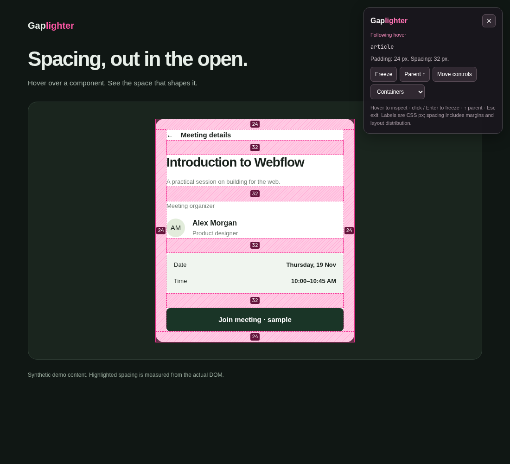

# Gaplighter

[](https://github.com/gitfudge0/Gaplighter/actions/workflows/ci.yml)

See the spacing inside a component without opening DevTools. A Chrome and Firefox extension that paints pink bands over padding and the visible space between child elements.



## Use it

1. Open a website, click the Gaplighter toolbar icon, then **Start inspection**.
2. Hover over a component. Labels show local **CSS pixels**.
3. Click or press Enter to freeze/resume. Use **Parent ↑** or the ↑ key to inspect its parent.
4. Switch from **Containers** to **Exact element** for precise targeting.
5. Use **Move controls** if the toolbar covers the component you want to inspect.
6. Press Esc or choose **×** to exit. Normal page interaction resumes.

While inspection is active, page clicks and pointer presses are intercepted to avoid activating links or submitting forms. Turn inspection off to use the page. Inspection and targeting state are kept in memory and reset on navigation; nothing is saved or uploaded.

## Install for development

Requires Node 22 or newer; Node 24 is used in CI.

```bash
npm ci
npm run build
```

**Chrome 114+:** open `chrome://extensions`, enable Developer mode, choose **Load unpacked**, and select `dist/chrome`. Pin the toolbar icon if needed. For `file://` pages, enable **Allow access to file URLs** in the extension's details.

**Firefox 142+:** open `about:debugging#/runtime/this-firefox`, choose **Load Temporary Add-on**, and select `dist/firefox/manifest.json`. Temporary add-ons disappear when Firefox closes. Normal Firefox installation requires a Mozilla-signed XPI; see [releasing](docs/releasing.md).

## What it measures

- Padding starts inside the element's borders.
- Empty space is measured between visually adjacent child boxes, including margins, CSS gaps and distributed space. It is labeled **spacing**, without attributing it to a CSS property.
- Flex rows/columns, wrapping, reverse direction, reordered children, grid rows/columns, block margins and `display: contents` are supported.
- Positive axis-aligned scaling is accounted for; labels remain local CSS pixels.
- Frozen selections follow layout changes and scrolling. Bands are clipped to rectangular ancestor scroll/overflow bounds and the viewport.
- The overlay uses a shadow root and the browser top layer to avoid page styles and stacking contexts.

## Deliberate limits

This is a DOM box inspector, not a pixel/typography analyzer. It measures gaps across the shared span of adjacent boxes; it does not infer a component's framework identity or a design token.

Rotated, skewed, mirrored, perspective/3D and SVG geometry, fragmented inline boxes, multi-column text, direct text nodes and generated content receive warnings instead of invented child spacing. Padding can still be shown when only child spacing is unsupported. Layouts with more than 80 rendered child boxes are not measured for child spacing. At most 160 bands are drawn. Complex overlapping/spanning layouts can omit partial gaps when a third box obstructs the band.

Iframes, canvas and video are inspected as outer boxes. Frame contents and closed shadow roots are not traversed. Browser internal pages, extension stores and some built-in viewers disallow injection. Clipping paths, masks and rounded corners are approximated with rectangular bounds. Overflowing or scrolled target containers hide padding bands rather than pinning them to a false edge. The inspector refreshes at up to roughly 12 frames per second while active, so animation tracking is approximate.

## Develop and verify

```bash
npm run build
npm run lint
npm test
npx playwright install chromium firefox
npm run test:browsers
npm run test:extensions
npm run package
```

`npm run check` runs build, lint, unit/package checks, browser regression checks and packaging. CI additionally runs installed-extension smoke tests. On Linux CI, `npx playwright install --with-deps chromium firefox` supplies the isolated runner's system dependencies.

For an already installed Chromium and task-local browser downloads:

```bash
PLAYWRIGHT_BROWSERS_PATH="$PWD/.fudge/qa-browsers" npx playwright install firefox
CHROMIUM_PATH=/usr/bin/chromium PLAYWRIGHT_BROWSERS_PATH="$PWD/.fudge/qa-browsers" npm run check
CHROMIUM_PATH=/usr/bin/chromium PLAYWRIGHT_BROWSERS_PATH="$PWD/.fudge/qa-browsers" npm run test:extensions
```

The browser suite exercises real rendering in both engines. Its inspector/popup tests simulate only extension API transport. Installed-extension smoke tests load MV3 bundles into **temporary profiles** and exercise real scripting/messaging, strict CSP, measurements, freezing and cleanup. A QA-only loopback host grant and background driver replace the physical toolbar `activeTab` gesture; neither is shipped. Native browser permission UI and store review are separate manual checks. No tests install into your normal browser profile.

See [verification details](docs/verification.md), [privacy](PRIVACY.md), and [release workflow](docs/releasing.md). Build output lives in ignored `dist/`; versioned ZIPs and SHA-256 checksums live in ignored `release/`.

## License

MIT. See [LICENSE](LICENSE).
